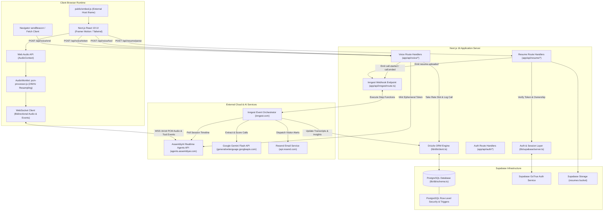
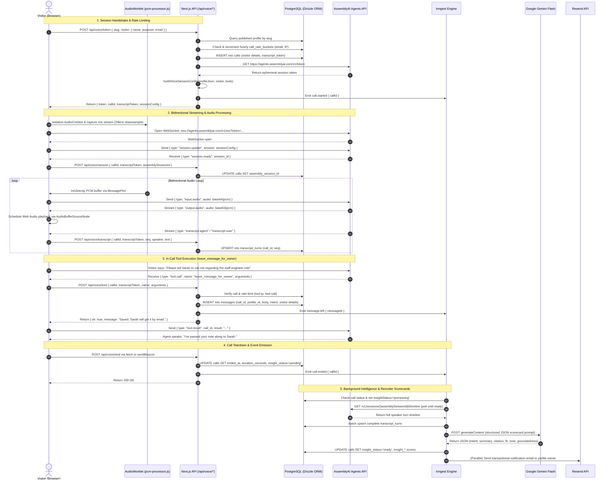

# System Architecture & Component Design

This document details the software architecture, component relationships, and communication protocols of Profili. It provides a formal design reference for the platform's multi-tier system topology, end-to-end call lifecycle, and asynchronous event streams.

---

## 1. High-Level System Topology

Profili operates across three main tiers: the **Client Browser Runtime**, the **Next.js Application Server** (hosting App Router React Server Components and Route Handlers), and a distributed layer of **Managed Infrastructure & AI Services** (Supabase, AssemblyAI, Google Gemini, and Inngest).

---

## 2. End-to-End Call Lifecycle Sequence

The sequence diagram below traces the complete lifecycle of a public voice interaction, from initial visitor form submission to real-time audio conversation, in-call tool calling, termination, and post-call intelligence generation.

---

## 3. Data Flow Architecture

The platform processes candidate information through three progressive states: **Raw Ingestion**, **Structured Profile Representation**, and **Real-Time Voice Prompt Projection**.

```mermaid
flowchart LR
    subgraph Ingestion["Stage 1: Raw Ingestion"]
        Upload["Candidate PDF Upload"] --> MagicCheck["Magic Byte Validation (%PDF)"]
        MagicCheck --> Unpdf["unpdf Text Extraction"]
        Unpdf --> RegexPii["Regex PII Stripping (Phone, Street)"]
    end

    subgraph Transformation["Stage 2: Structured Representation"]
        RegexPii --> GeminiParse["Gemini 3 Flash (Structured Output)"]
        GeminiParse --> ZodProfile["profileJsonSchema Validation"]
        ZodProfile --> DBStore[("PostgreSQL: profiles.profile_json")]
    end

    subgraph Projection["Stage 3: Voice Projection"]
        DBStore --> ToneConfig["Tone Calibration (Formality, Verbosity, Voice)"]
        ToneConfig --> Keyterms["Keyterm Extraction (Skills, Titles, Orgs)"]
        Keyterms --> SystemPrompt["System Prompt Assembly (lib/voice/session-config.ts)"]
        SystemPrompt --> AssemblySession["AssemblyAI Agent Session Configuration"]
    end
```

### Stage Details

1. **Ingestion & De-identification:**
   - Raw uploaded files are validated in [`lib/resume/sanitize.ts`](lib/resume/sanitize.ts) via `isPdfMagic` checking `0x25 0x50 0x44 0x46`.
   - Text extracted via `extractResumeText` ([`lib/resume/extract.ts`](lib/resume/extract.ts)) undergoes regular expression sanitization through `stripPrivateDetails` to redact street addresses and phone numbers.
2. **Schema-Constrained Generation:**
   - The sanitized plain text is wrapped in defensive delimiters (`RESUME_TEXT_BEGIN` / `RESUME_TEXT_END`) and submitted to Gemini Flash with `responseMimeType: "application/json"` and strict JSON schema enforcement ([`lib/resume/llm.ts`](lib/resume/llm.ts)).
   - Output data conforms to [`ProfileJson`](lib/resume/schema.ts), extracting employment history, education, highlighted accomplishments, skills, and projects.
3. **Voice Prompt Projection:**
   - When a call initializes, [`buildVoiceSessionConfig`](lib/voice/session-config.ts) extracts candidate keyterms (up to 80 terms, truncated to 48 chars each) to boost speech-to-text accuracy.
   - Formality ($0.0 \dots 1.0$) and verbosity ($0.0 \dots 1.0$) scalars are mapped onto explicit behavioral instructions (*more formal*, *balanced*, *more casual*; *concise*, *moderate*, *conversational*).
   - Strict hallucination boundaries are injected: `"Answer ONLY from the PROFILE block. If something isn't there, say you don't know and suggest contacting them directly."`

---

## 4. Subsystem Architecture

### 4.1 Application Layer (`app/`)
- **Route Handlers (`app/api/`):** Pure serverless endpoints handling JSON validation, authentication, rate limiting, and database mutations.
- **Protected App Workspace (`app/app/`):** Server and Client Components managing profile creation, resume reviews, voice calibration, live testing, messages review, and analytical scorecards.
- **Public Interactive Call Screens (`app/participant/[slug]/` & `app/talk/[username]/`):** Public-facing voice interfaces rendering the visualizer, handling Web Audio Worklets, and driving WebSocket communication. Supports iframe isolation with query parameter `?embed=1`.
- **Public Marketing & Pitch Deck (`app/page.tsx`, `app/presentation/`):** Modern presentation showcasing live audio waveform demonstrations, pricing matrices, and a 10-slide architectural deck.

### 4.2 Voice Subsystem (`lib/voice/`)
- **Token Manager (`assembly-token.ts`):** Mints short-lived (60s expiration) AssemblyAI Agent tokens with fallback duration limits (`[320, 300]` seconds).
- **Session Configurator (`session-config.ts`):** Constructs complete AssemblyAI initialization payloads, including tool signatures, voice model mappings, system prompts, and vocabulary boosting keys.
- **Tool Calling Framework (`tools.ts`, `tool-result.ts`, `tool-args.ts`):** Declares function specifications (`leave_message_for_owner`), handles JSON schema checking, and formats `tool.result` responses back into AssemblyAI event structures.
- **Call Timing & Rate Limiting (`call-window.ts`, `rate-limit.ts`, `ip.ts`):** Manages call window caps (`CALL_SECONDS = 300`), wrap-up thresholds (`CALL_WRAP_SECONDS = 270`), SHA-256 IP hashing, and atomic hourly bucket tracking.

### 4.3 Resume Subsystem (`lib/resume/`)
- **Text & PDF Extractor (`extract.ts`):** Integrates `unpdf` to parse PDF structures into raw utf-8 text streams.
- **LLM Pipeline (`llm.ts`):** Orchestrates multi-model failover across `gemini-3.8-flash`, `gemini-3.7-flash`, and `gemini-3.1-flash-lite` with low thinking levels for rapid parsing.
- **Schema & Sanitization (`schema.ts`, `sanitize.ts`):** Houses runtime Zod contracts for profiles, drafts, publish payloads, visitor inputs, and PII filters.
- **Profile Queries (`owner.ts`, `public.ts`):** Segregates database access between authenticated owner queries and public cached reads (`revalidateTag`).

### 4.4 Background Orchestration Subsystem (`lib/inngest/`)
- **Client & Events (`client.ts`, `emit.ts`):** Declares typed Inngest events (`resume.uploaded`, `call.started`, `call.ended`, `message.left`) and safe dispatch wrappers.
- **Call Finalization (`finalize-call.ts`):** Runs multi-step durable workflows: polling AssemblyAI timelines with exponential backoff, bulk-upserting transcript turns, and executing Gemini post-call intelligence.
- **Stale Session Guardian (`closeOpenCallJob` in `finalize-call.ts`):** Durable timeout listener that guarantees calls abandoned without clean beacons are automatically marked closed and analyzed.
- **Visitor Alerts (`notify-message.ts`):** Asynchronous email delivery through Resend notifying candidates of visitor messages.
- **Resume Parsing Worker (`parse-resume.ts`):** Concurrency-limited background pipeline for heavy PDF downloads, extraction, and drafting.

---

## 5. Architectural Boundaries & Data Access Rules

| Layer | Inbound Boundary | Outbound Access | Data Access Constraint |
| :--- | :--- | :--- | :--- |
| **Public Browser UI** | HTTP GET, Public URL | WebSocket (AssemblyAI), `/api/voice/*` | Zero database access; credentials restricted to public anon keys. |
| **API Route Handlers** | HTTP POST / GET | Drizzle ORM, Supabase Auth, AssemblyAI | Enforces authentication via `requireUser()` or session tokens (`transcriptToken`). |
| **Inngest Workers** | Inngest Webhook (`POST /api/inngest`) | PostgreSQL direct (`lib/db/client.ts`), External APIs | Operates as trusted system processes using direct DB connections. |
| **Database (PostgreSQL)** | PostgreSQL Wire Protocol | Drizzle ORM | Row-Level Security restricts unprivileged queries; views protect unpublished drafts. |
