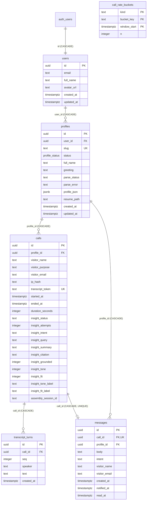
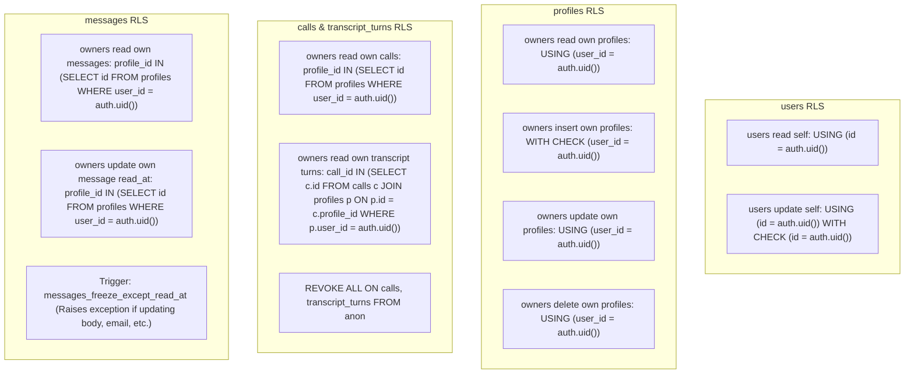

# Database Architecture & Schema Reference

This document provides the authoritative database design for Profili. The data layer utilizes PostgreSQL managed via Supabase and modeled strictly through [Drizzle ORM](https://orm.drizzle.team) in [`lib/db/schema.ts`](lib/db/schema.ts). Database migrations are maintained in the [`drizzle/`](drizzle/) directory with custom PostgreSQL Row-Level Security (RLS) policies, triggers, and storage configurations.

---

## 1. Entity-Relationship (ER) Diagram



---

## 2. Table-by-Table Data Dictionary

### 2.1 `users`
Mirrors authenticated Supabase `auth.users` identities into the application domain. Synchronized via PostgreSQL triggers.

| Column | Type | Constraints | Default | Description & Indexing |
| :--- | :--- | :--- | :--- | :--- |
| `id` | `uuid` | `PRIMARY KEY`, `REFERENCES auth.users(id) ON DELETE CASCADE` | None | Direct mapping to Supabase Auth UID. |
| `email` | `text` | `NULLABLE` | None | Candidate account email address. Indexed via `users_email_idx`. |
| `full_name` | `text` | `NOT NULL` | `""` | User full name derived from metadata. |
| `avatar_url` | `text` | `NULLABLE` | None | Profile picture URL from OAuth or gravatar. |
| `created_at` | `timestamptz` | `NOT NULL` | `now()` | Row creation timestamp. |
| `updated_at` | `timestamptz` | `NOT NULL` | `now()` | Managed automatically via trigger `users_set_updated_at`. |

---

### 2.2 `profiles`
Stores the candidate's agent representations, parsed resume entities, and speech calibration settings.

| Column | Type | Constraints | Default | Description & Indexing |
| :--- | :--- | :--- | :--- | :--- |
| `id` | `uuid` | `PRIMARY KEY` | `gen_random_uuid()` | Unique agent identifier. |
| `user_id` | `uuid` | `NOT NULL`, `REFERENCES users(id) ON DELETE CASCADE` | None | Owner account foreign key. Indexed via `profiles_user_id_idx`. |
| `slug` | `text` | `UNIQUE` (where not null) | None | URL slug for participant routes. Indexed via `profiles_slug_unique`. |
| `status` | `profile_status` | `NOT NULL`, Enum: `'draft'`, `'published'` | `'draft'` | Publishing state. Only `'published'` appears in public views. |
| `full_name` | `text` | `NOT NULL` | `""` | Display name of the candidate. |
| `greeting` | `text` | `NOT NULL` | `""` | Spoken opening line delivered by TTS when call opens. |
| `parse_status`| `text` | `NOT NULL` | `'idle'` | Inngest parse state: `'idle'`, `'parsing'`, `'ready'`, `'failed'`. |
| `parse_error` | `text` | `NULLABLE` | None | User-safe explanation of extraction or LLM errors. |
| `profile_json`| `jsonb`| `NOT NULL` | `'{}'::jsonb` | Structured JSON containing experience, skills, education, tone, and voice. |
| `resume_path` | `text` | `NULLABLE` | None | Storage key inside the `resumes` Supabase bucket (`${userId}/${fileId}.pdf`). |
| `created_at` | `timestamptz` | `NOT NULL` | `now()` | Creation timestamp. |
| `updated_at` | `timestamptz` | `NOT NULL` | `now()` | Managed automatically via trigger `profiles_set_updated_at`. |

---

### 2.3 `calls`
Ledger of every voice conversation initiated by a visitor. Houses duration tracking, AssemblyAI IDs, and post-call Gemini evaluations.

| Column | Type | Constraints | Default | Description & Indexing |
| :--- | :--- | :--- | :--- | :--- |
| `id` | `uuid` | `PRIMARY KEY` | `gen_random_uuid()` | Unique call identifier. |
| `profile_id` | `uuid` | `NOT NULL`, `REFERENCES profiles(id) ON DELETE CASCADE` | None | Target candidate profile. Indexed via `calls_profile_started_idx`. |
| `visitor_name`| `text` | `NOT NULL` | None | Self-reported visitor name from registration modal. |
| `visitor_purpose`| `text`| `NOT NULL` | None | Visitor's stated purpose (e.g., "Full-time role screen"). |
| `visitor_email`| `text` | `NOT NULL` | None | Self-reported visitor contact email. Indexed via `calls_email_started_idx`. |
| `ip_hash` | `text` | `NULLABLE` | None | SHA-256 hash of client IP for privacy-preserving rate limits. Indexed via `calls_ip_started_idx`. |
| `transcript_token`| `text` | `UNIQUE` | None | Ephemeral UUID authenticating client transcript & tool writes. |
| `started_at` | `timestamptz` | `NOT NULL` | `now()` | Timestamp when token was issued and call initiated. |
| `ended_at` | `timestamptz` | `NULLABLE` | None | Timestamp when call ended via beacon or Inngest timeout. |
| `duration_seconds`| `integer` | `NULLABLE` | None | Total duration of audio session in seconds. |
| `insight_status`| `text` | `NOT NULL` | `'idle'` | State: `'idle'`, `'pending'`, `'processing'`, `'ready'`, `'skipped'`, `'failed'`. |
| `insight_attempts`| `integer` | `NOT NULL` | `0` | Number of retries executed by Inngest insight evaluation. |
| `insight_intent`| `text` | `NULLABLE` | None | Short categorization (e.g., *Hiring screen*, *Peer deep-dive*). |
| `insight_query` | `text` | `NULLABLE` | None | Main visitor question summarized into one sentence. |
| `insight_summary`| `text` | `NULLABLE` | None | 2–4 sentence synthesis of dialogue and agent answers. |
| `insight_citation`| `text`| `NULLABLE` | None | Specific resume role or project referenced by agent. |
| `insight_grounded`| `integer`| `NULLABLE` | None | 0–100 integer measuring adherence to profile JSON facts. |
| `insight_tone` | `integer`| `NULLABLE` | None | 0–100 communication tone rating. |
| `insight_fit` | `integer`| `NULLABLE` | None | 0–100 candidate-visitor alignment rating. |
| `insight_tone_label`| `text`| `NULLABLE` | None | Descriptive tone label (e.g., "High", "Composed"). |
| `insight_fit_label`| `text` | `NULLABLE` | None | Descriptive fit label (e.g., "Strong match", "Moderate"). |
| `assembly_session_id`| `text`| `NULLABLE` | None | AssemblyAI Realtime Agents API session identifier. |

---

### 2.4 `transcript_turns`
Sequential, dialogue-level transcript records captured either live from client-streamed speech events or ingested from AssemblyAI session timelines.

| Column | Type | Constraints | Default | Description & Indexing |
| :--- | :--- | :--- | :--- | :--- |
| `id` | `uuid` | `PRIMARY KEY` | `gen_random_uuid()` | Unique turn identifier. |
| `call_id` | `uuid` | `NOT NULL`, `REFERENCES calls(id) ON DELETE CASCADE` | None | Foreign key linking turn to parent call. Indexed via `transcript_turns_call_idx`. |
| `seq` | `integer` | `NOT NULL` | None | Monotonically increasing sequence index (0, 1, 2...). Unique index on `(call_id, seq)`. |
| `speaker` | `text` | `NOT NULL` | None | Speaker role: `'visitor'` or `'agent'`. |
| `text` | `text` | `NOT NULL` | None | Utterance text (truncated at 8000 characters). |
| `created_at` | `timestamptz` | `NOT NULL` | `now()` | Ingestion timestamp. |

---

### 2.5 `messages`
Visitor follow-up inquiries and contact requests recorded through in-call function calling (`leave_message_for_owner`).

| Column | Type | Constraints | Default | Description & Indexing |
| :--- | :--- | :--- | :--- | :--- |
| `id` | `uuid` | `PRIMARY KEY` | `gen_random_uuid()` | Unique message identifier. |
| `call_id` | `uuid` | `NOT NULL`, `UNIQUE`, `REFERENCES calls(id) ON DELETE CASCADE` | None | One message permitted per call session. |
| `profile_id` | `uuid` | `NOT NULL`, `REFERENCES profiles(id) ON DELETE CASCADE` | None | Target profile. Indexed with created_at via `messages_profile_created_idx`. |
| `body` | `text` | `NOT NULL` | None | Confirmed visitor message in their words (1–500 chars). |
| `intent` | `text` | `NULLABLE` | None | Intent category: `'job_opportunity'`, `'question'`, `'introduction'`, `'other'`. |
| `visitor_name`| `text` | `NOT NULL` | None | Visitor name copied from call ledger. |
| `visitor_email`| `text` | `NOT NULL` | None | Visitor email copied from call ledger. |
| `created_at` | `timestamptz` | `NOT NULL` | `now()` | Submission timestamp. |
| `notified_at` | `timestamptz` | `NULLABLE` | None | Timestamp when transactional email was sent to candidate via Resend. |
| `read_at` | `timestamptz` | `NULLABLE` | None | Timestamp when candidate viewed message in dashboard. |

---

### 2.6 `call_rate_buckets`
High-performance atomic sliding-window rate limiting table. Truncated to the current hour.

| Column | Type | Constraints | Default | Description & Indexing |
| :--- | :--- | :--- | :--- | :--- |
| `kind` | `text` | `PRIMARY KEY` (Part 1) | None | Category: `'email'`, `'ip'`, `'tool-ip'`, `'tool-call'`. |
| `bucket_key` | `text` | `PRIMARY KEY` (Part 2) | None | Normalized email, SHA-256 IP hash, or call UUID. |
| `window_start`| `timestamptz` | `PRIMARY KEY` (Part 3) | None | Hourly bucket timestamp: `date_trunc('hour', now())`. |
| `n` | `integer` | `NOT NULL` | `0` | Counter incremented atomically up to limit of 5. |

---

## 3. Row-Level Security (RLS) & PostgreSQL Policies

Row-Level Security is explicitly enabled on all tables via [`drizzle/0001_rls_auth_storage.sql`](drizzle/0001_rls_auth_storage.sql) and [`drizzle/0005_messages.sql`](drizzle/0005_messages.sql).

### 3.1 Policy Breakdown



### 3.2 Public Data View (`public_profiles`)
To allow public visitors and unauthenticated sessions to access published agent information without granting direct `SELECT` access to the `profiles` table, a dedicated PostgreSQL view is defined:
```sql
CREATE OR REPLACE VIEW public.public_profiles
WITH (security_invoker = false)
AS
SELECT id, slug, full_name, greeting, profile_json
FROM public.profiles
WHERE status = 'published';

GRANT USAGE ON SCHEMA public TO anon, authenticated;
GRANT SELECT ON public.public_profiles TO anon, authenticated;
```
This guarantees drafts, private contact paths, and `parse_error` details are structurally impossible to leak to public visitors.

### 3.3 Message Immutability Trigger (`messages_freeze_except_read_at`)
To protect visitor messages from candidate tampering (e.g., editing visitor email addresses or altering inquiry text), a strict plpgsql trigger validates all `UPDATE` operations:
```sql
CREATE OR REPLACE FUNCTION public.messages_freeze_except_read_at()
RETURNS trigger LANGUAGE plpgsql AS $$
BEGIN
  IF NEW.id IS DISTINCT FROM OLD.id
    OR NEW.call_id IS DISTINCT FROM OLD.call_id
    OR NEW.profile_id IS DISTINCT FROM OLD.profile_id
    OR NEW.body IS DISTINCT FROM OLD.body
    OR NEW.intent IS DISTINCT FROM OLD.intent
    OR NEW.visitor_name IS DISTINCT FROM OLD.visitor_name
    OR NEW.visitor_email IS DISTINCT FROM OLD.visitor_email
    OR NEW.created_at IS DISTINCT FROM OLD.created_at
    OR NEW.notified_at IS DISTINCT FROM OLD.notified_at
  THEN
    RAISE EXCEPTION 'Only read_at can be updated on messages';
  END IF;
  RETURN NEW;
END;
$$;
```

---

## 4. Supabase Storage Architecture

Candidate resumes are isolated in a private Supabase Storage bucket named `resumes`.

### 4.1 Bucket Configuration
- **Bucket ID:** `resumes`
- **Visibility:** `public = false` (Restricted).
- **Max File Size:** `5242880` bytes (5 MB).
- **Allowed MIME Types:** `ARRAY['application/pdf']`.

### 4.2 Storage Security Policies (`storage.objects`)
Storage RLS ensures candidates can only access or modify resumes stored under their own user ID folder:
```sql
CREATE POLICY "users read own resumes" ON storage.objects FOR SELECT TO authenticated
USING (bucket_id = 'resumes' AND split_part(name, '/', 1) = auth.uid()::text);

CREATE POLICY "users upload own resumes" ON storage.objects FOR INSERT TO authenticated
WITH CHECK (bucket_id = 'resumes' AND split_part(name, '/', 1) = auth.uid()::text);

CREATE POLICY "users delete own resumes" ON storage.objects FOR DELETE TO authenticated
USING (bucket_id = 'resumes' AND split_part(name, '/', 1) = auth.uid()::text);
```

### 4.3 Cleanup Lifecycle
When a profile is deleted via [`DELETE /api/resume/profile`](app/api/resume/profile/route.ts), the handler invokes:
```typescript
await auth.supabase.storage.from("resumes").remove([existing.resume_path]);
```
This guarantees no orphaned PDF files remain in storage following agent deletion.
