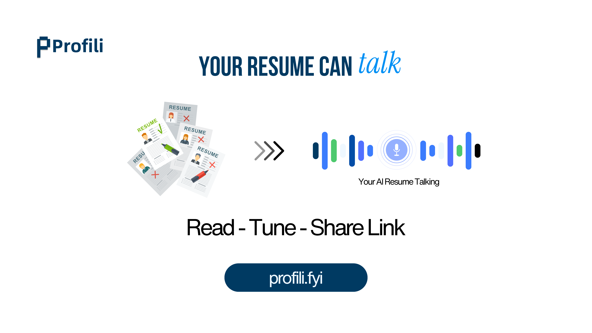
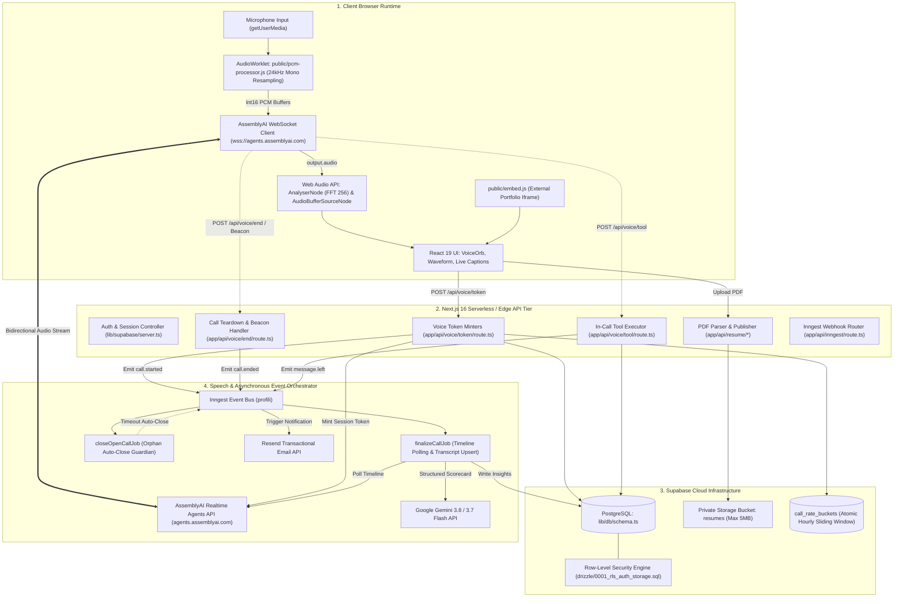

<div align="center">

  

  # Profili
  
  **Autonomous Real-Time Voice Resume Avatar & Post-Call Hiring Intelligence Platform**

  *Transform static resumes into interactive, low-latency conversational voice personas capable of fielding recruiter deep-dives, conducting technical screens, capturing in-call messages, and producing objective candidate scorecards.*

  <br />

  <p align="center">
    <a href="https://github.com/cipherorbitdev/Profili/blob/main/LICENSE"></a>
    <a href="https://nextjs.org/"></a>
    <a href="https://www.typescriptlang.org/"></a>
    <a href="https://react.dev/"></a>
    <a href="https://www.assemblyai.com/"></a>
    <a href="https://ai.google.dev/"></a>
    <a href="https://orm.drizzle.team/"></a>
    <a href="https://www.inngest.com/"></a>
    <a href="https://supabase.com/"></a>
  </p>

  <p align="center">
    <a href="#at-a-glance"><b>At a Glance</b></a> •
    <a href="#the-problem"><b>The Problem</b></a> •
    <a href="#what-profili-does"><b>What Profili Does</b></a> •
    <a href="#product-video"><b>Product Video</b></a> •
    <a href="#architecture"><b>Architecture</b></a> •
    <a href="#live-voice-pipeline"><b>Live Voice Pipeline</b></a> •
    <a href="#post-call-intelligence"><b>Post-Call Intelligence</b></a> •
    <a href="#verification--test-suite"><b>Verification</b></a> •
    <a href="#troubleshooting--faq"><b>FAQ</b></a> •
    <a href="#team--maintainers"><b>Team</b></a>
  </p>

</div>

---

<div align="center">
  
  <p><em>Figure 1: Live voice call interface showing real-time audio visualization, dynamic live captions, and post-call recruiter intelligence dashboard.</em></p>
</div>

---

## At a Glance

| Architectural Dimension | Engineering Implementation |
| :--- | :--- |
| **Product Purpose** | Interactive Voice Resume Avatar providing real-time, low-latency conversational interviews grounded strictly in candidate career facts. |
| **Primary Workflow** | PDF Resume Ingestion $\to$ PII Redaction $\to$ Gemini Structured Extraction $\to$ Voice Calibration $\to$ Realtime WebSocket Audio $\to$ Inngest Post-Call Analysis. |
| **Realtime Speech Layer** | **AssemblyAI Realtime Agents API** over WebSockets; client-side **AudioWorklet** (`pcm-processor.js`) performing 24kHz downsampling, 16-bit linear PCM streaming, and barge-in detection. |
| **Extraction & LLM** | **Google Gemini 3.8 / 3.7 Flash** with strict JSON `responseSchema` for resume entity parsing, hallucination boundaries, and post-call scorecard evaluations. |
| **State & Database** | **PostgreSQL** via **Drizzle ORM** (`drizzle-orm` v0.45, `drizzle-kit` v0.31); atomic sliding-window rate limit buckets (`call_rate_buckets`), immutable message triggers, and strict Row-Level Security (RLS). |
| **Background Orchestration**| **Inngest v4** durable serverless workflows: multi-step call finalization, timeline polling with exponential backoff, transcript aggregation, and automatic orphan session cleanup. |
| **Human-in-the-Loop Actions**| Candidate tone sliders (formality & verbosity), custom greeting overrides, voice selection preview, live call messaging (`leave_message_for_owner`), and dashboard insights review. |
| **Embeddable Distribution** | Zero-dependency 25-line embed script ([`public/embed.js`](public/embed.js)) rendering sandboxed iframes (`/participant/[slug]?embed=1`) for external portfolio sites. |
| **Quality Gates** | Node.js 22 native test runner (`node --experimental-strip-types --test`) verifying audio tools, session configuration, OAuth classification, and cookie security policies. |

---

## The Problem

Traditional talent acquisition and technical screening processes rely on fundamentally broken artifacts and fragmented communication channels:

```
┌─────────────────────────────────────────────────────────────────────────────┐
│                       TRADITIONAL SCREENING BOTTLENECK                      │
│                                                                             │
│   [ Static 2-Page PDF ] ──> Keyword Filter ──> Recruiter Phone Screen       │
│            │                       │                      │                 │
│            ▼                       ▼                      ▼                 │
│     Zero Interactive         High False-Negative     Multi-Week Scheduling  │
│        Context                 Rejection Rate             Deadlocks         │
└─────────────────────────────────────────────────────────────────────────────┘
```

1. **Keyword Screening Fatigue:** High-caliber engineers are routinely filtered out by rigid automated Applicant Tracking Systems (ATS) unable to discern nuance, project complexity, or adjacent technical proficiencies.
2. **Zero Conversational & Soft-Skill Signal:** A printed resume cannot convey clarity of thought, verbal technical articulation, problem-solving disposition, or communication composure under pressure.
3. **Severe Scheduling Latency:** Organizing 30-minute introductory phone screens across conflicting time zones introduces weeks of friction, resulting in lost candidates and high recruiter drop-off.
4. **Absence of Proactive Candidate Defense:** Static resumes cannot answer clarifying technical questions, provide context on architectural trade-offs, or defend technical stack selections made during past tenures.

---

## What Profili Does

Profili bridges this gap by provisioning a high-fidelity, real-time voice agent representing the candidate:

```
                                    PROFILI ARCHITECTURAL TOPOLOGY
                                    
  ┌────────────────────────┐         WebSocket (16-bit PCM Audio)         ┌───────────────────────────┐
  │     Visitor Browser    │ <══════════════════════════════════════════> │    AssemblyAI Agents API  │
  │                        │                                              │  - Low-Latency STT & TTS  │
  │  - AudioWorklet (24kHz)│ ──┐                                          │  - Voice Models (Alba)    │
  │  - Live Captions       │   │ POST /api/voice/tool                     │  - Interruption / Ducking │
  │  - Reactive Voice Orb  │   │ (leave_message_for_owner)                └─────────────┬─────────────┘
  └────────────────────────┘   │                                                        │
               │               ▼                                                        │
               │    ┌────────────────────────┐      Emit call.ended       ┌─────────────▼─────────────┐
               │    │   Next.js 16 Edge API  │ ─────────────────────────> │   Inngest Event Bus (v4)  │
               │    │  - Drizzle ORM         │                            │  - Poll Session Timeline  │
               └──> │  - Rate Limiting (5/h) │                            │  - Aggregate Transcripts  │
                    │  - Supabase SSR Auth   │ <───────────────────────── │  - Watchdog Auto-Close    │
                    └───────────┬────────────┘      Post-Call Scores      └─────────────┬─────────────┘
                                │                                                       │
                                ▼                                                       ▼
                    ┌────────────────────────┐                             ┌───────────────────────────┐
                    │  Supabase PostgreSQL   │                             │  Google Gemini 3.8 Flash  │
                    │  - profiles / calls    │                             │  - Adherence Grounding    │
                    │  - transcript_turns    │                             │  - Hiring Fit & Tone      │
                    │  - immutable messages  │                             │  - Dynamic Intent Label   │
                    └────────────────────────┘                             └───────────────────────────┘
```

- **Instant Agent Provisioning:** Upload any standard PDF resume. The platform verifies file integrity (`isPdfMagic`), strips PII via regex, extracts raw text via `unpdf`, and translates work histories into strict JSON contracts using Gemini Flash.
- **Natural Bidirectional Voice:** Visitors speak freely with the candidate's agent over low-latency WebSockets. The system supports full conversational barge-in, dynamic speech ducking, and sub-second speech-to-speech round trips.
- **Candidate-Controlled Tone Calibration:** Candidates calibrate their agent's personality across a multi-dimensional spectrum (formality, verbosity, and 9 curated voice models) alongside custom spoken greetings.
- **In-Call Visitor Messaging:** If a recruiter desires a direct follow-up, the voice agent triggers native function calling (`leave_message_for_owner`) to confirm and record a structured message, automatically alerting the candidate via Resend.
- **Post-Call Hiring Intelligence:** Following every conversation, an automated Inngest job aggregates speaker turns and runs structured Gemini evaluation scorecards (measuring factual grounding, communication tone, and role alignment).

---

## Product Video

Watch the complete product walkthrough demonstrating resume parsing, voice calibration, real-time audio interaction, and post-call analytics:

<div align="center">
  <a href="https://youtu.be/xRsNLj2A0h0" target="_blank">
    
  </a>
  <p><em>Watch the Production Walkthrough on YouTube (click above or visit <a href="https://youtu.be/xRsNLj2A0h0">https://youtu.be/xRsNLj2A0h0</a>)</em></p>
</div>

---

## Architecture

Profili is engineered as a distributed, event-driven system with clear isolation boundaries between client-side audio rendering, serverless API execution, relational state management, and real-time speech networks.



---

## Live Voice Pipeline

The live voice pipeline is designed for low latency, high resilience, and conversational fluidity:

### 1. Web Audio Resampling & Worklet Isolation
Browser hardware audio layers typically operate at 44.1kHz or 48kHz. Ingesting this directly into speech APIs introduces bandwidth waste and distortion. Profili executes [`public/pcm-processor.js`](public/pcm-processor.js) in a separate audio thread, downsampling native Float32 frames to 24kHz 16-bit linear PCM (`Int16Array`):

```javascript
// public/pcm-processor.js (Excerpt)
process(inputs) {
  const input = inputs[0]?.[0];
  if (!input) return true;
  const outLength = Math.max(1, Math.floor(input.length / this.ratio));
  const pcm16 = new Int16Array(outLength);
  for (let i = 0; i < outLength; i++) {
    const sample = input[Math.min(input.length - 1, Math.floor(i * this.ratio))] ?? 0;
    pcm16[i] = Math.max(-32768, Math.min(32767, Math.round(sample * 32767)));
  }
  this.port.postMessage(pcm16.buffer, [pcm16.buffer]);
  return true;
}
```

### 2. AssemblyAI Realtime Agents API Integration
Tokens are issued server-side via [`POST /api/voice/token`](app/api/voice/token/route.ts) with ephemeral 60-second TTLs and a strict session cap of 320 seconds (`ASSEMBLY_MAX_SESSION_SECONDS`). When the WebSocket connection (`wss://agents.assemblyai.com/v1/ws`) opens, the browser injects the candidate's dynamic session configuration.

### 3. Conversational Interruption & Speech Ducking (Barge-in)
When a visitor interrupts the agent:
1. AssemblyAI emits a `barge_in` event over the WebSocket.
2. The browser immediately halts all active `AudioBufferSourceNode` playback sources and resets the scheduled playback pointer (`playbackTimeRef.current = ctx.currentTime`).
3. The UI flashes a visual ripple indicator on [`VoiceOrb`](components/ui/voice-orb.tsx) for 2.8 seconds, acknowledging the user's interruption without stutter.

### 4. Curated Voice Persona Mapping
Candidates calibrate their agent across 9 acoustic models declared in [`lib/voice/assembly-voices.ts`](lib/voice/assembly-voices.ts):

| Voice ID | Display Label | Vibe | Accent | Gender | Persona Target |
| :--- | :--- | :--- | :--- | :--- | :--- |
| `charles` | Charles | Formal | British | M | Boardroom pace, deliberate, executive. |
| `michael` | Michael | Formal | American | M | Composed, corporate enterprise screening. |
| `vera` | Vera | Formal | British | F | Precise, measured, executive delivery. |
| `alba` | Alba *(Default)*| Casual | American | F | Warm, conversational, collaborative. |
| `jane` | Jane | Casual | American | F | Balanced, approachable, engineering peer. |
| `jean` | Jean | Casual | American | M | Relaxed, everyday discussion cadence. |
| `eve` | Eve | Energetic | American | F | Forward-leaning, bright, fast-paced startup. |
| `george` | George | Energetic | American | M | Direct, upbeat, entrepreneurial pace. |
| `anna` | Anna | Energetic | British | F | Crisp, lively technical problem solver. |

---

## Post-Call Intelligence

Every conversation undergoes automated post-call synthesis via [`lib/voice/insights.ts`](lib/voice/insights.ts) and [`finalizeCallJob`](lib/inngest/finalize-call.ts):

```
┌─────────────────────────────────────────────────────────────────────────────┐
│                       POST-CALL SCORECARD SPECIFICATION                     │
│                                                                             │
│  {                                                                          │
│    "intent": "Founder intro",          // Dynamic classification            │
│    "query": "Can you scale Kafka?",   // Core question in 1 sentence        │
│    "summary": "Visitor questioned...", // 2-4 sentence synthesis             │
│    "citation": "Staff Engineer Role", // Resume proof point pointer         │
│    "grounded": 98,                    // 0-100 adherence to resume facts    │
│    "tone": 92,                        // 0-100 communication score          │
│    "fit": 95,                         // 0-100 recruiter match score        │
│    "tone_label": "High",              // Categorical tone label             │
│    "fit_label": "Strong match"        // Categorical fit assessment         │
│  }                                                                          │
└─────────────────────────────────────────────────────────────────────────────┘
```

1. **Authoritative Timeline Reconciliation:** Inngest polls AssemblyAI's timeline endpoint with exponential backoff until the full speaker dialogue resolves. Initial client-side live captions are replaced with authoritative speaker turns.
2. **Schema-Constrained Evaluation:** The transcript turns and verified profile facts are fed into Gemini 3.8 Flash with `generationConfig.responseSchema` enforcing [`callInsightSchema`](lib/resume/schema.ts).
3. **Objective Grounding:** If an agent answers a question not present in the candidate's uploaded background, the model penalizes `insight_grounded` and flags the discrepancy.
4. **Offline Recruiter Alerts:** If the visitor used the in-call tool (`leave_message_for_owner`), [`notifyMessageJob`](lib/inngest/notify-message.ts) delivers a transactional plain-text email to the candidate via Resend containing the visitor's verified message.

---

## Configuration Reference Matrix

Ensure the following environment variables are configured in `.env.local` or your production deployment dashboard:

| Variable Name | Required | Target Runtime | Purpose & Architectural Scope |
| :--- | :---: | :--- | :--- |
| `DATABASE_URL` | **Yes** | Server | PostgreSQL connection string for Drizzle ORM (use port 6543 pooler for serverless). |
| `DATABASE_URL_MIGRATE`| **Yes** | CI/CD / Local | Direct connection string to PostgreSQL (port 5432) for running `pnpm db:migrate`. |
| `NEXT_PUBLIC_SUPABASE_URL` | **Yes** | Shared | Canonical URL of the Supabase project instance. |
| `NEXT_PUBLIC_SUPABASE_ANON_KEY` | **Yes** | Shared | Public anon key for client-side Supabase SSR session handling. |
| `SUPABASE_SERVICE_ROLE_KEY` | **Yes** | Server | Admin secret key for server-side PDF downloads in background Inngest jobs. |
| `ASSEMBLYAI_API_KEY` | **Yes** | Server | Secret API key used to mint ephemeral tokens and fetch session timelines. |
| `GEMINI_API_KEY` | **Yes** | Server | Google AI Studio key powering resume extraction and post-call evaluation scorecards. |
| `GEMINI_PARSE_MODEL` | No | Server | Primary model override (defaults to `gemini-3.8-flash`, with `3.7-flash` fallback). |
| `INNGEST_EVENT_KEY` | **Yes** | Server | Secret key used by `lib/inngest/emit.ts` to dispatch events to Inngest Cloud. |
| `INNGEST_SIGNING_KEY` | **Yes** | Server | Key verifying authenticity of incoming webhooks to `POST /api/inngest`. |
| `RESEND_API_KEY` | **Yes** | Server | Transactional email key for sending visitor message notifications to candidates. |
| `NEXT_PUBLIC_SITE_URL` | **Yes** | Shared | Base URL (e.g., `https://profili.fyi` or `http://localhost:3000`) for cookie flags & SEO. |

---

## Verification & Test Suite

Profili leverages the native Node.js 22 test runner with experimental type-stripping (`node --experimental-strip-types --test`) for fast, zero-dependency unit verification.

```bash
# Execute the complete automated verification test suite
pnpm test
```

### Verified Test Suites

```
✔ lib/voice/tools.test.ts
  - leave_message_for_owner schema matches AssemblyAI function tool specifications.
  - Verifies toolPromptLines injects wrap-up timing constraints.

✔ lib/voice/tool-result.test.ts
  - buildToolResult correctly structures call_id, tool_call_id, and JSON stringified results.
  - Verifies backwards-compatible echo across AssemblyAI event variants.

✔ lib/voice/assembly-voices.test.ts
  - Confirms all 9 stored AssemblyAI voice IDs resolve cleanly.
  - Legacy UI alias mappings (Alex -> alba, Emma -> jane, Daniel -> michael) map onto valid voice targets.

✔ lib/auth/safe-next.test.ts
  - Proves safeNextPath rejects protocol-relative URLs (//evil.com), backslashes, and domain jumps.
  - Confirms white-listed redirection exclusively to /app, /app/*, or /reset-password.

✔ lib/auth/account-providers.test.ts
  - Validates provider classification logic for Google OAuth vs. password credentials.

✔ lib/supabase/cookie-options.test.ts
  - Verifies that localhost origins NEVER receive Secure cookie flags (preventing dev lockouts).
  - Confirms production HTTPS hosts strictly enforce Secure, HttpOnly, and SameSite=Lax.
```

---

## Troubleshooting & FAQ

<details>
<summary><b>1. Why does the browser fail to connect to the voice WebSocket?</b></summary>
<br />
Voice connections fail if either:
<ul>
  <li><code>ASSEMBLYAI_API_KEY</code> is missing or expired in your environment variables.</li>
  <li>Microphone permissions were denied by the browser. Check that your browser has permission to access your audio input device.</li>
  <li>Hourly rate limits were reached (check network response for HTTP <code>429 Too Many Requests</code>).</li>
</ul>
</details>

<details>
<summary><b>2. How does the system handle abandoned or dropped calls?</b></summary>
<br />
When a call begins, an Inngest watchdog function (<code>closeOpenCallJob</code>) is scheduled for 390 seconds (300s call limit + 90s grace period). If the visitor closes the browser tab without triggering <code>navigator.sendBeacon</code>, the watchdog automatically closes the call record, calculates duration, and emits <code>call.ended</code> to trigger post-call intelligence.
</details>

<details>
<summary><b>3. How is candidate PII protected from public callers?</b></summary>
<br />
All extracted resume text is scrubbed before being written to the database or injected into prompts. Regular expressions in <code>lib/resume/sanitize.ts</code> remove phone numbers and street addresses. Furthermore, the AssemblyAI system prompt explicitly forbids the agent from answering queries about contact details, directing visitors to use the built-in message tool instead.
</details>

<details>
<summary><b>4. Can I embed my voice avatar onto my personal portfolio?</b></summary>
<br />
Yes! Simply include the zero-dependency script located in <code>public/embed.js</code> on your external website:
<pre><code>&lt;script src="https://profili.fyi/embed.js" async&gt;&lt;/script&gt;
&lt;div data-profili-slug="your-custom-slug"&gt;&lt;/div&gt;</code></pre>
This automatically mounts a responsive, sandboxed iframe with microphone and audio playback permissions.
</details>

---

## Detailed Documentation Suite

For deeper architectural, schema, and API specifications, explore the specialized technical documentation:

- [System Architecture](ARCHITECTURE.md) — Comprehensive topology, component sequences, and data flows.
- [API Reference](API_REFERENCE.md) — Exhaustive catalog of all Next.js App Router route handlers.
- [Database & Storage](DATABASE.md) — Drizzle schema, entity diagrams, data dictionaries, and RLS policies.
- [Voice & Audio Pipeline](VOICE_PIPELINE.md) — AudioWorklet PCM processing, WebSocket events, and tone calibration.
- [Background Workflows](BACKGROUND_JOBS.md) — Inngest orchestration, timeline polling, and Gemini scoring.
- [Security & Authentication](SECURITY_AND_AUTH.md) — Threat model, cookie handling, and PII redaction heuristics.
- [Production Deployment](DEPLOYMENT.md) — Multi-cloud operations across Vercel, Supabase, and Inngest.
- [Contributing Guide](CONTRIBUTING.md) — Local development setup, coding standards, and PR workflows.

---

## Team & Maintainers

Profili is developed and maintained by **[cipherorbitdev](https://github.com/cipherorbitdev)**.

Contributions, issues, and feature requests are welcome. Feel free to check the [issues page](https://github.com/cipherorbitdev/Profili/issues).

---

## License

This project is licensed under the **MIT License** — see the [LICENSE](LICENSE) file for details.
